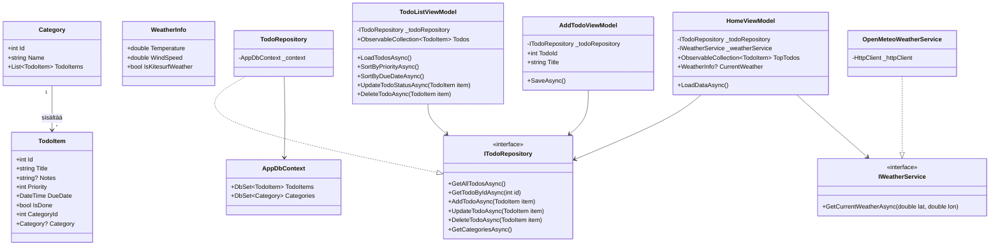

# LifeManagementApp

**Tekijä:** Jesse Mattila

.NET MAUI -sovellus arjen hallintaan, joka yhdistää priorisoidun tehtävälistan ja reaaliaikaiset säätiedot sekä ilmoittaa, kun ulkona on kitesurf-keli.

## Ominaisuudet

- **Etusivu (Home):**
  - Näyttää 3 tärkeintä keskeneräistä tehtävää järjestettynä ensin prioriteetin (suurin ensin) ja sitten eräpäivän (aikaisin ensin) mukaan.
  - Hakee ajantasaisen lämpötilan ja tuulen nopeuden (m/s) Vaasaan Open-Meteo REST-rajapinnasta.
  - Näyttää selkeän **🪁 Kitesurf-keli!** -ilmoituksen, kun tuulen nopeus ylittää 5 m/s.
  - Virheenkäsittely verkkokatkosten varalle (sovellus ei kaadu ilman verkkoyhteyttä).
- **Tehtävälista (Tehtävät):**
  - Listaa kaikki tehtävät (`CollectionView`), prioriteettivärit (`PriorityToColorConverter`) ja kategoriat.
  - Mahdollistaa listan järjestämisen prioriteetin tai eräpäivän mukaan.
  - Tehtävien merkitseminen tehdyksi, muokkaus (parametrinvälitys Shell-reitityksellä) sekä poisto (`SwipeView` / painike).
- **Tehtävän lisäys ja muokkaus:**
  - Lomake uuden tehtävän luontiin ja olemassa olevan muokkaamiseen (otsikko, lisätiedot, kategoria, prioriteetti 1–5, eräpäivä).
  - Syötteen validointi: tyhjää otsikkoa ei hyväksytä.
- **Paikallinen tallennus:**
  - SQLite-tietokanta ja Entity Framework Core Code First (`AppDbContext`), jossa on 1–N-relaatio (`Category` – `TodoItem`).

## Ajo-ohje

### Vaatimukset
- Visual Studio 2022 (tai uudempi), jossa asennettuna **.NET Multi-platform App UI development** -työkuorma.
- .NET 9 / .NET 10 SDK.

### Käynnistys
1. Kloonaa repositorio:
   ```bash
   git clone https://github.com/MattilaJesse/LifeManagementApp.git
   ```
2. Avaa `LifeManagementApp.slnx` Visual Studiossa.
3. Palauta NuGet-paketit (`Build -> Restore NuGet Packages`).
4. Valitse kohdelaitteeksi **Windows Machine** tai **Android Emulator** ja käynnistä sovellus painamalla **F5**.

## Luokkakaavio



## Tekoälyn käyttö

Projektin kehityksessä on hyödynnetty **Google Gemini** -tekoälyä seuraaviin tarkoituksiin:
- Projektin kansiorakenteen, MVVM-arkkitehtuurin ja kerrosjaon (Models, Data, Services, ViewModels, Views) suunnitteluun.
- EF Core Code First -tietokantamallien, Open-Meteo REST -rajapintakutsun sekä XAML-käyttöliittymäpohjien rakentamiseen ja virhetilanteiden ratkomiseen.
- Koodiratkaisujen läpikäyntiin.